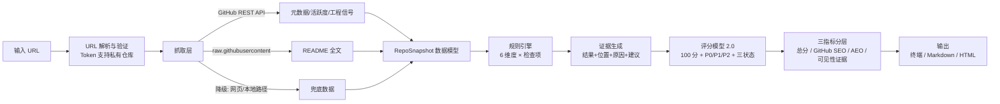

# 项目大纲：GitHub 仓库 SEO 体检工具（RepoSEO Analyzer）

> 版本：v0.3 ｜ 日期：2026-10-19 ｜ 状态：评分模型 2.0（6 维度）+ AI 优化建议模块已纳入设计，技术栈 Python
> 配套文档：**设计文档（权威规格）→ `docs/DESIGN.md`**（含 §10 AI 优化建议模块）；M2/M3/M3.5 开发以设计文档为准

---

## 0. 一句话定位

**输入一个 GitHub 仓库 URL（公开或带 Token 的私有仓库）→ 自动抓取仓库元数据与 README → 按「GitHub 原生搜索优化 + AI 检索曝光（AEO）」方法论逐项体检 → 输出可发现性评分（Repository Discoverability Score）+ 逐条证据 + 优化建议与原因。**

工具衡量的是**优化准备度（readiness）**，不宣称等于真实搜索排名；真实曝光由外部证据验证（见 §5 三指标分层）。

---

## 1. 背景与痛点

- **发现路径变了**：开源项目被"看到"面对三条检索通道——① GitHub 站内搜索；② Google/搜索引擎；③ AI 工具（ChatGPT、Perplexity、Gemini、Copilot）。三者都依赖**仓库元数据 + README 文本质量**。
- **现有工具只报数不治病**：gitstar-ranking、OSS Insight 等侧重 stars/趋势统计，不解决"内容如何优化"。
- **机会点**：把 SEO/AEO 方法论固化为**证据驱动的规则引擎**，自动给出「问题 → 建议 → 原因 → 示例」。

## 2. 目标用户与成功标准

| 项 | 内容 |
|---|---|
| 目标用户 | 开源项目作者/维护者、开源运营（含私有仓库开发期体检） |
| 核心价值 | 不解释"为什么要做 SEO"，直接告诉"哪里没做好、怎么改、改了为什么有用" |
| 验收标准 | ① 输入 URL → 输出评分 + 逐条证据 + 建议 + 原因；② 规则覆盖 6 维度全部检查项且可溯源；③ 用 RepoRadar（私有 + Token）完成端到端实测并产出真实报告 |

---

## 3. 核心功能（版本规划）

### MVP（命令行工具）
1. **URL 解析与验证**：支持 `https://github.com/owner/repo`、`git@…`、`.git`；**支持 GITHUB_TOKEN 读取私有仓库**（用户自有仓库开发期即可体检）；识别 404 / 限流 / 网络受限并给出诊断。
2. **信息抓取**：GitHub REST API（名称、描述、topics、license、默认分支、最近推送、release、issue 等）+ raw 抓取 README；降级链 `API → raw → 网页解析 → 本地仓库路径`。
3. **规则引擎**：6 维度 × 全部检查项（§4），每条规则产出**证据**（检测结果 + 证据位置 + 扣分原因 + 修复建议）。
4. **评分模型 2.0**：100 分制、6 维度加权、问题分级 P0/P1/P2；支持「已验证 / 未发现证据 / 无法检测」三状态。
5. **终端报告**：总分 + 维度得分 + 最优先修复问题 + 证据清单。

### V1（增强）
- 导出 **Markdown / HTML 报告**；
- **规则可配置**（权重、开关、自定义规则）、阈值校准；
- 修复建议可**一键导出为优化清单**（可直接照做）；
- **AI 优化建议（M3.5）**：把评分规则 + 检查结果交给 LLM，生成贴合项目语义的建议（问题/建议/原因/示例/预计影响），失败自动降级为规则模板；评分仍由确定性引擎决定，AI 永不改分。

### V2（扩展，明确预留）
- **Google 收录检查**：Search Console 授权（有授权才判"已验证"，否则标"无法检测"）；
- **多模型 AEO 实测**：对 ChatGPT / Gemini / Perplexity 跑真实查询，观察项目是否被提及/引用（真实曝光度，区别于静态准备度）；
- **分项趋势监控**：定期检测维度得分变化；
- **Web 界面**。

---

## 4. 评分模型 2.0（6 维度 × 100 分）

> 设计原则：评价的不是"做得是否规范"，而是**"是否容易被发现、是否容易被理解、是否有机会被搜索和 AI 系统正确引用"**。工程健康保留但独立，不与搜索可见性混为一谈。

| 维度 | 权重 | 检查项与分值 |
|---|---|---|
| **README 内容质量** | 25 | 项目定位与价值主张 5 ｜ 关键词与语义覆盖 5 ｜ 快速开始与使用示例 5 ｜ 内容结构与链接完整性 5 ｜ AEO 友好内容 5 |
| **仓库元数据** | 20 | 仓库名称 4 ｜ Description 6 ｜ Topics 6 ｜ 主语言与分类定位 2 ｜ 官网/文档/演示链接 2 |
| **AI 检索准备度** | 20 | 实体与项目身份清晰度 4 ｜ 功能与适用场景表达 4 ｜ 可引用的事实与示例 4 ｜ 结构化文档与语义组织 4 ｜ 信息一致性与限制说明 4 |
| **搜索可发现性** | 15 | 仓库页面可访问性 3 ｜ 搜索引擎收录证据 4 ｜ 文档站可抓取性 3 ｜ Sitemap 与规范 URL 2（不适用不扣分） ｜ 内外部链接完整性 3 |
| **工程健康与可信度** | 10 | License 2 ｜ CI 与自动化 2 ｜ 测试与质量保障 2 ｜ Release 与版本管理 2 ｜ 依赖/安装/安全信息 2 |
| **项目活跃度** | 10 | 近期有效维护 3 ｜ Issue 处理与响应 3 ｜ Release 与版本更新 2 ｜ 贡献活动与协作 2 |

**评分细则（关键约束）**：
- **README 不求长、不求关键词次数**：写了 30 次 "AI Agent" 但没说清解决什么问题 → 语义覆盖低分；
- **Topics 不是越多越好**：无关标签扣分，重复/宽泛标签不加分；
- **活跃度不数 commit**：频繁提交 ≠ 质量高，成熟项目长期稳定不被惩罚；按项目类型、发布周期动态评估；
- **不适用/未知不扣分**：无独立文档站 → Sitemap 项标"N/A"；无 Search Console 授权 → 收录项标"无法检测"，绝不把"未检测到"当"未收录"。

---

## 5. 三指标分层（最终输出结构）

不要只给一个总分。总指标 + 三个子指标，**静态审计与真实曝光严格分离**：

| 指标 | 含义 | 数据来源 |
|---|---|---|
| **Repository Discoverability Score**（总） | 仓库可发现性评分，即 100 分总分 | 6 维度静态审计 |
| **GitHub SEO Score** | 原生搜索相关性、元数据与内容质量 | README 25 + 元数据 20 + 工程健康 10（可配置归并） |
| **AEO Readiness Score** | AI 是否容易理解项目、提取事实、找到可引用内容 | AI 检索准备度 20 + README 中 AEO 检查项 |
| **Search Visibility Evidence** | 实际收录、搜索提及、模型回答引用的验证数据 | 外部证据：Google 收录检查、多模型实测（V2） |

> 铁律：三个子指标不得混成一个分数后宣称"SEO 排名提高了"。静态审计衡量**优化准备度**，真实曝光需外部数据验证。

### 评分展示模板（示意数据，非真实结果）

```text
76 / 100 ｜ 仓库可发现性评分（Repository Discoverability Score）
整体基础良好，仍有可修复的可发现性问题。
（总分代表优化准备度，不代表真实搜索排名。）

维度得分
  README 内容质量     21 / 25
  仓库元数据          17 / 20
  AI 检索准备度       14 / 20
  搜索可发现性        10 / 15
  工程健康与可信度     8 / 10
  项目活跃度           6 / 10

最优先修复的问题
  P0 补充明确的项目定位与使用场景
     影响：README 内容质量、AI 检索准备度
     建议：首屏明确项目用途、目标用户与核心差异
  P1 核实外部搜索引擎的收录情况
     影响：搜索可发现性
     建议：通过搜索结果或站长工具核验，而非依赖静态推断
```

---

## 6. 评分机制（4 项，让分数可信可查）

### 6.1 证据驱动评分
每个检查项输出：**检测结果 → 证据位置（文件/行/URL）→ 扣分原因 → 修复建议 → 修复示例**。不允许只显示"README 18/25"，必须说明为什么丢了 7 分。

```text
[R09 项目定位与价值主张]  5/5
  证据：README 首段（L3-5）"RepoRadar is a CLI tool that monitors your GitHub repos..."
  结论：通过 —— 首屏即说明是什么与解决什么

[R16 关键词与语义覆盖]  2/5
  证据：全文 "repo monitoring" 仅出现 1 次，无同义覆盖
  结论：扣 3 分 —— 核心用途缺少同义词（monitor / track / watch / alert）
  建议：在 Features 与 FAQ 中自然覆盖同义表达
```

### 6.2 硬性规则 vs 语义判断（分开标记）
| 类型 | 判定方式 | 示例 |
|---|---|---|
| 硬性规则 | 程序确定，无歧义 | License 是否存在、链接是否 404、Topics 是否为空、Sitemap 是否存在 |
| 语义判断 | 规则启发 + AI 辅助，标置信度 | 定位是否清晰、内容是否有价值、语义是否一致 |

- 报告中用图标/标签区分（如 `[硬性]` / `[语义·置信 0.8]`）；
- 语义判断结果可配置人工复核，**不得把 AI 判断伪装成事实**。

### 6.3 「不适用 / 未知」三状态
所有外部证据类检查项输出状态：**已验证（有证据）｜ 未发现证据（明确检测不到）｜ 无法检测（无授权/不可达）**。
- 无文档站 → Sitemap 项 = N/A（不扣分，不记缺失）；
- 无 Search Console 授权 → 收录项 = 无法检测（不判定为未收录）。

### 6.4 分项趋势与优化优先级
- 输出**最值得修复的问题 Top 3**，每条标注：影响哪些维度、预计改善哪些指标、修复成本；
- 防止"为提分做无实际价值的修改"（如无意义堆砌关键词）；
- V2 增加历史趋势：维度得分随时间变化曲线。

---

## 7. 规则库设计（核心资产，按 6 维度组织）

### 规则通用结构

```python
@dataclass
class Rule:
    id: str                      # R01、R02…
    dimension: str               # readme / metadata / aeo / discoverability / health / activity
    check_type: Literal["hard", "semantic"]   # 硬性规则 / 语义判断
    score: float                 # 该项分值
    priority: Literal["P0", "P1", "P2"]
    check: Callable[[RepoSnapshot], RuleResult]

@dataclass
class RuleResult:
    status: Literal["pass", "fail", "n_a", "unknown"]   # 三状态
    score_earned: float
    evidence: str                # 证据位置与内容
    reason: str                  # 扣分/通过原因
    suggestion: str              # 修复建议
    example: str | None = None   # 修复示例
```

### 规则清单（目标 ≥ 44 条，覆盖 §4 全部检查项）

| 维度 | 代表规则（节选） |
|---|---|
| README（25） | R01 首段定位与价值主张 ｜ R02 关键词与同义语义覆盖 ｜ R03 安装命令可执行 ｜ R04 Quick Start 最小示例完整 ｜ R05 标题层级与 TOC ｜ R06 内部链接有效 ｜ R07 AEO 友好（FAQ/定义/限制说明） |
| 元数据（20） | R10 仓库名规范 ｜ R11 Description 非空/≤350/关键词前置 ｜ R12 Topics 数量与精准度（无关词扣分） ｜ R13 主语言识别 ｜ R14 官网/演示链接有效 |
| AEO（20） | R20 实体身份一致性（名/作者/用途/技术栈） ｜ R21 功能与适用场景表达 ｜ R22 可引用事实与示例 ｜ R23 结构化语义组织 ｜ R24 信息一致性与限制说明（不夸大） |
| 可发现性（15） | R30 仓库公开可访问 ｜ R31 搜索引擎收录证据（V2 外部核验） ｜ R32 文档站可抓取性 ｜ R33 Sitemap（N/A 不扣分） ｜ R34 内外链接完整性 |
| 工程健康（10） | R40 License ｜ R41 CI 配置 ｜ R42 测试目录 ｜ R43 Release/版本管理 ｜ R44 依赖与安全信息 |
| 活跃度（10） | R50 近期有效维护（按项目类型动态阈值） ｜ R51 Issue 响应 ｜ R52 Release 节奏 ｜ R53 贡献者与协作 |

### 规则示例（示范"证据 + 原因"写法）

> **R11 · Description**
> - 状态：fail（硬性）｜ 扣 6 分
> - 证据：仓库 About 为空（API 返回 description=null）
> - 建议：`Lightweight TypeScript ORM for SQLite, zero dependencies, supports migration and batch insert for Node.js.`
> - 原因：Description 是 GitHub 站内搜索摘要、Google 结果标题、AI 读取项目的第一信息来源；缺关键词直接决定"搜这个词时仓库排不排得上"。

> **R07 · AEO 友好内容（FAQ）**
> - 状态：fail（语义，置信 0.85）｜ 扣 2 分
> - 证据：README 无 FAQ 章节；"Does it support Windows?" 类问句 0 条
> - 建议：新增 `## FAQ`，标题用问句
> - 原因：人类提问 = LLM 检索 query，问句标题最容易被 Perplexity/ChatGPT 直接摘引，是 AEO 性价比最高的板块。

> **R12 · Topics（反例）**
> - 状态：fail（硬性）｜ 扣 3 分
> - 证据：topics = [ai, llm, javascript, python, seo] 与项目定位（ORM for SQLite）无关联
> - 原因：无关标签稀释相关性，GitHub 与 AI 均会降低对该仓库的主题匹配度；精准 > 数量。

---

## 8. 技术架构

### 8.1 数据流



### 8.2 模块划分（Python）

| 模块 | 职责 |
|---|---|
| `cli` | Typer 命令行入口、参数解析、Token 配置 |
| `fetcher` | GitHub API 客户端（httpx）+ raw 抓取 + 降级链；私有仓库认证 |
| `model` | `RepoSnapshot` 数据模型 + `Evidence` / `RuleResult` 类型 |
| `rules` | 规则库，按维度分文件，硬性/语义分开实现 |
| `scoring` | 权重计算、维度分、总分、P0/P1/P2、三状态归并 |
| `report` | 终端渲染 / Markdown / HTML 报告 |
| `verify` | （V2）Google 收录检查、多模型 AEO 实测的外部验证通道 |

### 8.3 关键设计决策

1. **Token 优先**：`GITHUB_TOKEN` 环境变量 → 未认证限流 60 次/时（实测 403）；有 Token 可读**私有仓库**（RepoRadar 场景），未认证则自动降级。
2. **降级链**：API → raw → 网页解析 → 本地仓库路径，任一层失败自动降级并标注证据来源。
3. **硬性/语义分离**：语义判断调用规则启发式，可选接入 LLM（可配置），结果标置信度，绝不伪装成事实。
4. **三状态贯穿**：所有外部证据类检查项输出 verified / not_found / unknown，避免误判。
5. **规则数据驱动**：规则声明（分值/类型/优先级）+ 检测函数分离，新增规则不动引擎。

---

## 9. 技术选型（Python）

| 层 | 选型 | 理由 |
|---|---|---|
| 语言 | Python 3.11+ | 已确认；生态成熟、便于后续接 LLM/爬虫 |
| CLI | Typer | 类型提示友好、自动 help 文档 |
| HTTP | httpx（同步+异步） | 超时/重试/代理可控 |
| 解析 | markdown-it-py（README）+ BeautifulSoup（网页降级） | 结构化解析 Markdown/HTML |
| 语义判断 | 规则启发式 + 可选 LLM 接口（openai/volc 等，可配置） | V1 先用规则，V2 增强 |
| 报告 | 模板字符串 + markdown；HTML 用 jinja2 | 产物可直接进 GitHub |
| 测试 | pytest + responses（mock API） | 规则单测友好 |
| 打包 | pyproject.toml + hatchling，发布 PyPI | `pip install repo-seo` |

---

## 10. 项目目录结构

```text
github-seo/                      # 本项目根目录（E:\code-workspace\ai-code\github-seo）
├── PROJECT_OUTLINE.md           # 本大纲
├── docs/
│   ├── methodology.md           # SEO/AEO 方法论（规则理论依据）
│   └── rule-references.md       # 规则 ↔ 方法论 ↔ 评分分值对照表（可溯源）
├── packages/
│   └── repo-seo/
│       ├── src/repo_seo/
│       │   ├── __init__.py
│       │   ├── cli.py           # Typer 入口
│       │   ├── fetcher/         # github_api.py / raw_reader.py / fallback.py
│       │   ├── model/           # snapshot.py / evidence.py / enums.py
│       │   ├── rules/           # readme.py / metadata.py / aeo.py / discoverability.py / health.py / activity.py
│       │   ├── scoring/         # weights.py / scorer.py / priorities.py
│       │   ├── verify/          # (V2) google_index.py / model_probe.py
│       │   └── report/          # terminal.py / markdown.py / html.py
│       ├── tests/               # pytest + fixture 仓库数据
│       ├── examples/            # 示例报告（含 RepoRadar 私有实测）
│       └── pyproject.toml
└── README.md                    # 项目说明（工具自身吃自己的狗粮）
```

---

## 11. 里程碑计划

| 阶段 | 周期（约） | 交付物 |
|---|---|---|
| M1 脚手架 + 抓取层 | 0.5 周 | Python 工程初始化、URL 解析、Token 私有仓库支持、API+raw+降级、RepoSnapshot；**RepoRadar（私有 + Token）实测抓取** |
| M2 规则库 v1 | 1 周 | 6 维度全部检查项规则 + 证据生成 + pytest 单测（fixture 数据，通过/失败/N-A/unknown 四类用例） |
| M3 评分 2.0 + 报告 | 0.5 周 | 6 维度加权评分、三状态、P0/P1/P2、终端报告（总分 + 维度 + 优先修复） |
| M3.5 AI 优化建议 | 0.5 周 | advice 模块：LLM 客户端（OpenAI 兼容）+ Prompt 组装 + schema 校验 + 模板兜底；`--ai / --no-ai / --model` |
| M4 端到端验证 | 0.5 周 | RepoRadar 私有实测报告 + 对照 1 个公开标杆仓库校准权重与阈值 |
| M5 V1 增强 | 1 周 | Markdown/HTML 报告、规则可配置、优化清单导出 |
| V2 扩展 | 视需求 | Google 收录检查（Search Console 授权）、多模型 AEO 实测、趋势监控、Web |

> 前置：RepoRadar 提供可用的 GITHUB_TOKEN（私有读取）；如需真实曝光验证，后续需转为公开仓库。

---

## 12. 测试与验收

- **单元测试**：每条规则 ≥ 2 个用例（通过/失败），外部证据类规则另测 N/A 与 unknown 状态；
- **集成测试**：真实仓库 3 个——RepoRadar（私有 + Token）+ 1 个高排名公开标杆 + 1 个普通公开仓库；
- **端到端验收清单**：
  - [ ] `repo-seo https://github.com/xxx/yyy`（带/不带 Token）3 秒内输出报告；
  - [ ] 每个检查项含证据位置 + 扣分原因 + 修复建议；
  - [ ] 硬性规则与语义判断明确标记，语义结果带置信度；
  - [ ] 无文档站/无授权场景输出 N/A 或"无法检测"，不误扣分；
  - [ ] 报告含总分、维度得分、Top3 优先修复问题，可导出 Markdown/HTML；
  - [ ] 私有仓库 Token 场景端到端跑通（RepoRadar）。

---

## 13. 风险与对策

| 风险 | 对策 |
|---|---|
| GitHub API 未认证限流（实测 403） | Token 引导 + 缓存 + 降级链 |
| RepoRadar 为私有仓库，外部不可检索 | 工具支持 Token 读取（开发期可体检）；**同时输出 P0 警告：私有状态无法被 GitHub 搜索/Google/AI 爬取，需公开才有曝光** |
| 语义判断误判 | 硬性/语义分离 + 置信度标注 + 可人工复核 |
| 三状态边界被误用（未检测=未收录） | 状态枚举强制：verified / not_found / unknown，报告模板固化 |
| 单仓库验证过拟合 | M4 用 3 个不同类型仓库校准 |
| 为提分做无价值修改 | 修复建议标注"影响维度 + 预计改善指标"，杜绝堆砌关键词类伪优化 |

---

## 14. 后续扩展路线图

1. **AI 一键改写（V2）**：在 M3.5 建议模块之上，由 LLM 直接产出"优化后的 About + README 草稿"（工具从诊断进化到治疗）；
2. **多模型 AEO 实测**：ChatGPT / Gemini / Perplexity 真实查询，检测是否被提及/引用（真实曝光证据）；
3. **Google 收录监控**：Search Console 授权后核验收录状态与变化；
4. **定时趋势**：维度得分历史曲线、异常告警；
5. **批量对比 + Web**：多仓库矩阵、浏览器插件。

---

## 15. 下一步（评审后即启动）

1. 技术栈已确认 Python（Typer + httpx + markdown-it-py）；
2. **准备 RepoRadar 的 GITHUB_TOKEN**（私有仓库读取用；开发期不需要仓库公开）；
3. 从 M1 开始：初始化 `packages/repo-seo` 脚手架 + 抓取层，先跑通「URL → RepoSnapshot」并实测 RepoRadar；
4. 同步沉淀 `docs/methodology.md`（把 SEO/AEO 方法论正式化，作为规则依据）。
