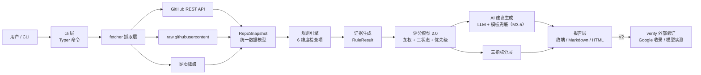

# RepoSEO Analyzer · 项目设计文档

| 项 | 内容 |
|---|---|
| 项目 | GitHub 仓库可发现性体检工具（RepoSEO Analyzer / `repo-seo`） |
| 文档版本 | v0.2 |
| 日期 | 2026-10-19 |
| 状态 | M1–M5 与 V2 均已实现 ✅（最后更新 2026-10-22；实现状态以代码与本节 §12 为准） |
| 关联文档 | `PROJECT_OUTLINE.md`（项目大纲 v0.2）；AI 优化建议模块设计已并入 §10 |

---

## 1. 背景与目标

### 1.1 背景

开源项目被"看到"的路径有三条，权重规则各不相同但都依赖**仓库元数据 + README 文本质量**：

1. **GitHub 站内搜索**：仓库名、Description、Topics、README、活跃度；
2. **Google / 搜索引擎**：抓取公开页面、Description、README 文本；
3. **AI 检索（AEO）**：ChatGPT / Perplexity / Gemini / Copilot 语义理解 README，决定回答用户问题时是否推荐该项目。

现有工具（gitstar-ranking、OSS Insight 等）只做数据统计，不解决内容优化问题。

### 1.2 目标

> 输入一个 GitHub 仓库 URL（公开或带 Token 的私有仓库），自动抓取仓库信息，按「GitHub 原生搜索优化 + AI 检索曝光（AEO）」方法论逐项体检，输出**可发现性评分 + 逐条证据 + 优化建议与原因**。

衡量的是**优化准备度（readiness）**，不是真实排名。

### 1.3 非目标（明确不做）

- 不宣称能直接提升 GitHub / Google / AI 排名（静态审计 ≠ 真实曝光）；
- 不提供刷星、刷 fork 等灰产手段；
- 不做全网爬虫/大规模数据抓取（仅针对单仓库）；
- 不做 GitHub 之外的平台内容生成（V2 的模型实测仅做"是否被引用"检测）。

### 1.4 设计原则（贯穿全文）

1. **证据驱动**：每个检查项必须输出「检测结果 + 证据位置 + 扣分原因 + 修复建议」，不允许只给分数；
2. **硬性 / 语义分离**：程序可判定的（License 存在、链接 404）与需要语义判断的（定位是否清晰）分开标记，语义判断带置信度；
3. **三状态**：外部证据类检查项输出 `verified / not_found / unknown`，绝不把"未检测到"当"未收录"；
4. **降级链**：任何抓取层失败自动降级，不静默失败、不阻断整体；
5. **静态 ≠ 真实**：总分代表优化准备度；真实曝光由外部证据（收录检查、模型实测）单独验证；
6. **AI 增强可解释**：AI 只负责生成建议文本，评分/证据/权重由确定性引擎决定；AI 失败自动降级为规则模板，不影响主流程。

---

## 2. 用户故事与核心场景

| 场景 | 输入 | 期望输出 |
|---|---|---|
| S1 公开仓库体检 | `repo-seo scan https://github.com/owner/repo` | 评分 + 证据 + 建议，3 秒内 |
| S2 私有仓库体检 | 同上 + `GITHUB_TOKEN` | 抓取成功；「搜索可发现性」输出 P0 警告（私有无法被外部检索） |
| S3 报告导出 | `--json` / 报告命令 | JSON / Markdown / HTML 报告 |
| S4 收录核验（V2） | Search Console 授权 / 模型查询 | 已验证的收录与引用证据 |

---

## 3. 系统总览

### 3.1 分层架构



### 3.2 模块职责

| 模块 | 路径 | 状态 | 职责 |
|---|---|---|---|
| cli | `src/repo_seo/cli.py` | ✅ | 命令入口、参数、Token 注入、错误提示 |
| fetcher | `src/repo_seo/fetcher/` | ✅ | 抓取与降级（§5） |
| model | `src/repo_seo/model/` | ✅ | RepoSnapshot 数据模型（§4.1） |
| rules | `src/repo_seo/rules/` | ✅ M2 | 规则库（§6） |
| scoring | `src/repo_seo/scoring/` | ✅ M3 | 评分聚合（§7） |
| report | `src/repo_seo/report/` | ✅ M3 | 报告渲染（§8） |
| advice | `src/repo_seo/advice/` | ✅ M3.5 | AI 建议生成与模板兜底（§10） |
| workspace | `src/repo_seo/advice/workspace.py` | ✅ V2.3 | 本地仓库副本、一键应用与 unified diff（§10.10） |
| verify | `src/repo_seo/verify/` | ✅ V2 | Google 收录、多模型 AEO 实测（§11） |

---

## 4. 数据模型

### 4.1 RepoSnapshot（已实现）

抓取层把多来源数据归一化的统一结构，规则引擎只依赖它。

```python
@dataclass
class RepoSnapshot:
    # 基础元数据
    full_name: str            # owner/name
    owner: str
    name: str
    description: str | None   # About 描述
    topics: list[str]
    language: str | None      # 主语言
    license_spdx: str | None
    visibility: Visibility    # public / private
    default_branch: str
    homepage: str | None
    has_pages: bool
    archived: bool
    created_at / pushed_at / updated_at: str | None
    stars / forks / open_issues / watchers: int

    # README
    readme_text: str | None
    readme_source: str | None   # api / raw / web / local / none

    # 工程信号
    root_files: list[str]
    has_license_file / has_ci / has_tests / has_gitignore
    has_contributing / has_code_of_conduct: bool
    package_meta: dict          # package.json / pyproject.toml 关键字段

    # 活跃度
    releases: list[dict]
    contributors: list[dict]

    # 抓取过程
    fetch_errors: list[str]
    fetched_at: str
```

### 4.2 规则与证据模型（M2 规格）

```python
class CheckType(str, Enum):
    HARD = "hard"          # 程序可判定，无歧义
    SEMANTIC = "semantic"  # 语义判断，带置信度

class EvidenceStatus(str, Enum):
    PASS = "pass"          # 通过（得满分）
    FAIL = "fail"          # 未通过（按扣分）
    N_A = "n_a"            # 不适用（不计入分母）
    UNKNOWN = "unknown"    # 无法检测（不计入分母，报告标注）

@dataclass
class Rule:
    id: str                # 如 R01 / M02 / A03 / D01 / H01 / AC01
    dimension: str         # readme / metadata / aeo / discoverability / health / activity
    name: str              # 检查项名
    score: float           # 满分分值
    check_type: CheckType
    priority: Literal["P0", "P1", "P2"]
    confidence: float | None = None   # 语义检查项的置信度

@dataclass
class RuleResult:
    rule_id: str
    status: EvidenceStatus
    score_earned: float
    evidence: str          # 证据位置与内容（文件/行/URL/原文摘录）
    reason: str            # 通过/扣分原因
    suggestion: str        # 修复建议
    example: str | None    # 修复示例
```

---

## 5. 抓取层设计（M1 已实现）

### 5.1 文件与职责

| 文件 | 职责 |
|---|---|
| `url_parser.py` | 解析 `https://github.com/owner/repo`、`git@…`、`owner/repo`，去 `.git` 后缀 |
| `github_api.py` | REST API 客户端：get_repo / readme(base64) / 根文件树 / releases / contributors；错误映射（RateLimit / NotFound / 401） |
| `raw_reader.py` | raw.githubusercontent 兜底；**严格短超时 + 总预算**（见 5.3） |
| `fallback.py` | 公开仓库网页降级（bs4 解析 description / topics）；私有仓库跳过 |
| `fetch.py` | 编排：多来源归一化为 RepoSnapshot；错误进 `fetch_errors` 不阻断 |

### 5.2 抓取顺序与降级链

```text
元数据:  API get_repo（必须成功，失败即终止）
README:  API readme → raw 兜底 → 网页（仅公开仓库）
根文件:  API git/trees → contents 降级
活跃度:  API releases → contributors（失败仅告警）
```

### 5.3 超时与限流策略（实测校准）

| 目标 | 策略 | 依据 |
|---|---|---|
| api.github.com | `Timeout(connect=5, read=10)` | 实测 <3s，正常 |
| raw.githubusercontent.com | `Timeout(connect=3, read=6)` + 阶段总预算 10s | 实测出现连接黑洞：挂起 155s 且超时不生效，必须总预算兜底 |
| github.com 网页 | `Timeout(connect=5, read=10)` | 私有仓库跳过；公开仓库仅在关键字段缺失时使用 |
| 未认证 API | 限流 403 → 提示配置 `GITHUB_TOKEN` | 实测触发（60 次/时） |
| Token | 环境变量 `GITHUB_TOKEN` 或 `--token`；支持私有仓库 | 私有仓库必须 |

---

## 6. 规则引擎设计（M2）

### 6.1 规则加载机制

- 规则以「声明（分值/类型/优先级）+ 检测函数」组织，按维度分文件：
  `rules/readme.py`、`metadata.py`、`aeo.py`、`discoverability.py`、`health.py`、`activity.py`；
- 新增规则不改引擎：引擎只负责遍历规则、收集 `RuleResult`；
- 语义检查项支持配置外部 LLM（可插拔），V1 默认规则启发式 + 置信度标注。

### 6.2 评分模型 2.0 · 维度与检查项规格（权威定义）

> 设计原则：评价「是否容易被发现、被理解、被正确引用」，而非规范性本身。工程健康独立保留，不与搜索可见性混同。

#### D1 README 内容质量（25 分）

| ID | 检查项 | 分值 | 类型 | 检测方法（基于 RepoSnapshot） | 通过条件 |
|---|---|---|---|---|---|
| R01 | 项目定位与价值主张 | 5 | 语义 | 解析 README 首段（H1 后首个文本段） | 首段 ≥ 60 字符，说明"是什么+解决什么"；不含"练习/placeholder/待更新"等弱词 |
| R02 | 关键词与语义覆盖 | 5 | 语义 | 从 description/topics 提取核心词，统计在 README 中的自然出现与同义变体 | 核心词出现 ≥3 次或有 ≥2 种同义表达，且无堆砌（无 >10 次密集重复） |
| R03 | 快速开始与使用示例 | 5 | 硬性+语义 | 正则匹配安装命令（pip/npm/cargo/go install）；代码块存在且标注语言 | 有可复制安装命令 + ≥1 个带语言标注的代码示例 |
| R04 | 内容结构与链接完整性 | 5 | 硬性 | markdown 解析：H1 唯一、标题层级连续、代码块语言标注比例、README 内链接 | H1 存在且唯一；H2/H3 层级无跳级；链接抽查无 404 |
| R05 | AEO 友好内容 | 5 | 语义 | 检测 FAQ / 定义段 / 限制说明 / 使用场景段 | 至少包含 FAQ、Definitions、Limitations、Use Cases 之一且内容非空 |

#### D2 仓库元数据（20 分）

| ID | 检查项 | 分值 | 类型 | 检测方法 | 通过条件 |
|---|---|---|---|---|---|
| M01 | 仓库名称 | 4 | 硬性 | 名称长度、分隔符、与描述语义 | 长度 3~40；非 my-/demo-/test-/xxx 模式；含领域词 |
| M02 | Description | 6 | 硬性+语义 | description 非空、长度、关键词前置、语言 | 非空且 ≤350 字符；核心词在前 80 字符；非全中文（建议英文） |
| M03 | Topics | 6 | 硬性+语义 | topics 数量、与描述/README 语义相关度 | 1~20 个；≥6 个最佳；无关标签（与项目主题无关联）每条扣分 |
| M04 | 主语言与分类定位 | 2 | 硬性 | language 字段 | 非空（仓库有代码提交） |
| M05 | 官网/文档/演示链接 | 2 | 硬性 | homepage 非空且可达（HTTP 200） | 有有效入口；无则 0 分 |

#### D3 AI 检索准备度（20 分）—— 本项目差异化维度

| ID | 检查项 | 分值 | 类型 | 检测方法 | 通过条件 |
|---|---|---|---|---|---|
| A01 | 实体与项目身份清晰度 | 4 | 语义 | description、README 首段、README 标题中项目名/用途/技术栈一致性 | 项目名与描述一致；技术栈在首段明确 |
| A02 | 功能与适用场景表达 | 4 | 语义 | README 是否回答"它是什么、适合谁" | 存在 Use Cases / Who is it for / 适用场景段落 |
| A03 | 可引用的事实与示例 | 4 | 语义+硬性 | 具体功能清单、代码示例、配置示例、API 文档链接 | 存在可被 LLM 摘引的具体内容（列表式功能 + ≥1 代码块） |
| A04 | 结构化文档与语义组织 | 4 | 硬性+语义 | 标题层级、FAQ、配置说明、功能列表 | 标题层级规范；有列表/表格等可抽取结构 |
| A05 | 信息一致性与限制说明 | 4 | 语义 | 检测夸大表述（"最好/第一/完美"）、是否声明兼容性/限制 | 无夸大词；有限制/兼容性/版本要求说明 |

#### D4 搜索可发现性（15 分）

| ID | 检查项 | 分值 | 类型 | 检测方法 | 通过条件 |
|---|---|---|---|---|---|
| D01 | 仓库页面可访问性 | 3 | 硬性 | visibility、archived、抓取过程无阻断 | public 且非 archived（私有 → 0 分 + P0 警告） |
| D02 | 搜索引擎收录证据 | 4 | 外部（Google Custom Search API） | `site:github.com/owner/repo` 核验（`--verify`） | 静态引擎无授权 → UNKNOWN（不计分，标注"未验证"）；`--verify` 有证据才在 Search Visibility Evidence 中计为已验证 |
| D03 | 文档站可抓取性 | 3 | 硬性 | homepage / GitHub Pages 可访问、正文可读 | 有文档站且页面 200；无文档站 → N/A 不计分 |
| D04 | Sitemap 与规范 URL | 2 | 硬性 | 文档站 sitemap.xml / robots.txt | 有文档站时存在 sitemap；无文档站 → N/A 不计分 |
| D05 | 内外部链接完整性 | 3 | 硬性 | README/描述中链接状态抽查 | 链接有效（HTTP 非 404）；死链每条扣分 |

#### D5 工程健康与可信度（10 分）

| ID | 检查项 | 分值 | 类型 | 检测方法 | 通过条件 |
|---|---|---|---|---|---|
| H01 | License 与开源许可说明 | 2 | 硬性 | LICENSE 文件 + license_spdx | 文件存在且 SPDX 可识别 |
| H02 | CI 与自动化检查 | 2 | 硬性 | 根文件含 workflow 等 CI 配置 | 存在 CI 配置 |
| H03 | 测试及质量保障 | 2 | 硬性 | tests / spec 目录或测试配置 | 存在 |
| H04 | Release 与版本管理 | 2 | 硬性 | releases 非空且 tag 语义化 | 有 ≥1 个 Release |
| H05 | 依赖、安装及安全信息 | 2 | 硬性 | 包元信息（package.json / pyproject.toml 的 description/keywords） | 包元信息完整 |

#### D6 项目活跃度（10 分）

| ID | 检查项 | 分值 | 类型 | 检测方法 | 通过条件（动态） |
|---|---|---|---|---|---|
| AC01 | 近期有效维护 | 3 | 硬性 | pushed_at 距今间隔 | 创建 <1 年：90 天内推送；创建 ≥1 年：180 天内推送（成熟项目放宽） |
| AC02 | Issue 处理与响应 | 3 | 硬性+语义 | open_issues 数量、近期 closed issue | 有 issue 且近期有响应；无 issue 历史 → UNKNOWN（不计分） |
| AC03 | Release 与版本更新 | 2 | 硬性 | 最近 release 距今 | 180 天内有 Release；从未发布 → 0 分 |
| AC04 | 贡献活动与协作 | 2 | 硬性 | contributors 数量、CONTRIBUTING | 贡献者 ≥2 或有 CONTRIBUTING 文件 |

### 6.3 优先级定义

| 级别 | 定义 | 典型规则 |
|---|---|---|
| P0 | 直接阻断可发现性：搜不到 / AI 完全无法理解 | 私有仓库（D01）、无 README（R01~R05 全空）、空 Description（M02）、空 Topics（M03） |
| P1 | 明显削弱搜索与 AI 引用概率 | 缺 FAQ/AEO 段（R05）、无 CI（H02）、无 License（H01）、活跃度低 |
| P2 | 锦上添花，增强权威与转化 | 多语言 README、外链、Discussions、文档站（D03/D04） |

### 6.4 规则库规模

目标 ≥ 40 条（上表 29 条为权威基线，R 系列可按 AEO 细节拆分扩充；每条规则必须有可复现的检测函数与单测）。

### 6.5 规则可配置化（--config，已实现）

规则不硬编码为不可变：通过 TOML 配置文件支持三档自定义（`repo-seo rules --export-config` 生成模板）：

| 能力 | 配置项 | 影响 |
|---|---|---|
| 启用/禁用 | `enabled = true/false` | 禁用后该规则不检测、不计分 |
| 分值覆盖 | `score = 6.0` | 维度满分按启用规则分值**动态计算**（默认 = 权重 25/20/20/15/10/10） |
| 优先级覆盖 | `priority = "P0"` | 影响 Top3 排序 |
| 阈值参数 | `params = { key = value }` | 仅部分规则支持（见下表） |

可配阈值参数（默认值 → 说明）：

| 规则 | 参数（默认值） |
|---|---|
| R01 | min_chars=60（README 首段最小字符） |
| R02 | min_hits=3（核心词最小命中）、max_hits=30（堆砌阈值） |
| M02 | max_desc_chars=350（Description 最大长度） |
| M03 | min_topics=6（Topics 数量下限）、max_topics=20（GitHub 硬上限） |
| AC01 | new_threshold=90 / mature_threshold=180 / age_cutoff=365（活跃度窗口） |

设计约束：
- 未知规则 id / 非法参数名 / 非法值 → 启动即报错（ConfigError，退出码 2），不静默忽略；
- 自定义配置下报告标注「已应用自定义规则配置」，维度满分随启用规则动态计算——**自定义分数不代表官方评分模型**；
- 默认配置行为与基线完全一致（动态满分 = 固定权重，已由测试保障）。

---

## 7. 评分模型与聚合（M3）

### 7.1 维度权重（总分 100）

| 维度 | 权重 |
|---|---|
| README 内容质量 | 25 |
| 仓库元数据 | 20 |
| AI 检索准备度 | 20 |
| 搜索可发现性 | 15 |
| 工程健康与可信度 | 10 |
| 项目活跃度 | 10 |

### 7.2 聚合规则

```text
维度分 = Σ(该维度检查项实得分)
可评分值 = Σ(该维度检查项分值) − Σ(N_A 项分值) − Σ(UNKNOWN 项分值)
总分 = Σ所有维度实得分 / Σ所有可评分值 × 100
```

- **N/A**：不适用（如无文档站时的 D04）→ 从分母剔除，不扣分；
- **UNKNOWN**：无法检测（如无授权时的 D02）→ 从分母剔除，报告标注"未验证"；
- **扣分归因**：每个扣分项必须携带 evidence + reason + suggestion；
- **防伪优化**：报告附 Top3 修复问题，标注影响维度与预计改善指标，防止"为提分做无价值修改"（如堆砌关键词）。

### 7.3 三指标分层（输出结构）

| 指标 | 构成 | 说明 |
|---|---|---|
| Repository Discoverability Score | 总分 100 | 优化准备度 |
| GitHub SEO Score | README 25 + 元数据 20 + 工程健康 10 | 原生搜索相关性 |
| AEO Readiness Score | AI 检索准备度 20 + README 中 AEO 项 | AI 理解/引用准备度 |
| Search Visibility Evidence | D02 收录证据 + V2 模型实测 | 真实曝光验证（不混入总分宣称） |

### 7.4 报告结构（终端 / Markdown / HTML 一致）

```text
76 / 100 ｜ 仓库可发现性评分
维度得分（6 行）
最优先修复问题 Top3（问题 / 影响维度 / 建议 / 预计改善）
逐项证据清单（折叠式：通过项简要、扣分项完整）
三指标分层
```

---

## 8. 报告层（M3）

| 渲染 | 输出 | 用途 |
|---|---|---|
| 终端 | 评分摘要 + Top3 + 扣分项证据 | 快速体检 |
| Markdown | 完整证据清单 + 三指标 | 存档 / 提交 PR |
| HTML | 可视化报告（维度条形 + 证据折叠） | 分享 / 展示 |

---

## 9. 外部验证层 verify（V2，已实现）

| 能力 | 说明 | 状态 |
|---|---|---|
| Google 收录检查 | Google Custom Search JSON API 执行 `site:` 查询核验；未配置 GOOGLE_CSE_API_KEY/CSE_ID → UNKNOWN | ✅ 已实现 |
| 多模型 AEO 实测 | 复用 OpenAI 兼容 LLM 探测「是否知道该仓库」，输出提及/未提及 + 回答摘录 | ✅ 已实现 |
| 趋势监控 | 定期体检：scan+record+trend；历史存储 .repo-seo-history/；SVG 曲线（总分+6 维度） | ✅ 已实现 |

设计约束：
- 外部验证是「Search Visibility Evidence」，与静态评分（GitHub SEO Score / AEO Readiness）**分开呈现**，不混入总分；
- 状态三分：已验证（indexed/提及）/ 未发现证据（not_indexed/未提及）/ 无法检测（unknown/error），「未配置」≠「未收录」；
- AEO 探测为「模型训练知识采样」，非实时检索，单次回答存在随机性——报告如实标注；
- CLI：`repo-seo scan <url> --verify`；环境变量 GOOGLE_CSE_API_KEY / GOOGLE_CSE_ID / REPO_SEO_PROBE_MODELS（逗号分隔多模型）。

## 9.1 趋势监控（V2.2，已实现）

| 能力 | 说明 |
|---|---|
| 历史存储 | `history.py`：每仓库一个 `.repo-seo-history/{owner}__{repo}.json`，时间戳升序追加 SnapshotRecord（at/total/dimensions{earned,eligible,total}/url/source/note）；同时间戳去重；损坏文件备份 `.corrupt.json` 后重建，不阻塞体检 |
| 趋势分析 | `trend.py`：analyze_trend 首末对比 → delta_total / delta_dimensions / direction（up/down/flat）；render_trend_svg 零依赖 SVG 折线（总分黑 + 6 维度定色，Y 轴 0/25/50/75/100，X 轴首/中/末刻度） |
| 趋势报告 | `report.py`：终端 / Markdown / HTML（自包含内联样式 + SVG 曲线） |
| CLI | `repo-seo monitor <url>`（定时体检入口：scan → score → 追加历史 → 输出趋势；--token/--config/--history-dir/--md/--html）；`repo-seo trend <url>`（只读历史出曲线，无网络） |

定时机制：本工具为无守护进程 CLI，「定时体检」由外部 cron / CI / 豆包定时任务周期调用 `repo-seo monitor <url>` 实现——每次调用只做一次体检并追加历史，天然幂等可重入。

---

## 10. AI 优化建议模块（M3.5）

### 10.1 目标与原则

**目标**：把评分规则与检查结果交给 LLM，生成比静态模板更贴合项目语义的优化建议（问题 + 建议 + 原因 + 可复制示例 + 预计影响）。

**原则（延续 §1.4）**：
- 评分与证据仍 100% 由确定性规则引擎产出（可复现、可单测）；
- AI 建议是可解释增强：失败降级为规则模板，不影响主流程；
- 私有仓库数据发送给模型服务商前必须显式提示用户。

### 10.2 数据流

```mermaid
flowchart LR
    RS[RepoSnapshot] --> RE[规则引擎 RuleResult[]]
    RE --> PKG[建议打包器<br/>截断 + 摘要]
    PKG --> PROMPT[Prompt 组装<br/>角色 + 规则定义 + 检查结果]
    PROMPT --> LLM[LLM 客户端<br/>OpenAI 兼容]
    LLM -->|JSON| PARSE[解析与校验<br/>schema + 重试×1]
    PARSE --> ADV[AIAdvice[]]
    ADV --> REP[报告层]
    RE -->|本地模板| TPL[模板建议兜底]
    TPL --> REP
    PARSE -- 失败 --> TPL
```

### 10.3 Prompt 组成（输入）

| 段 | 内容 | 说明 |
|---|---|---|
| 系统角色 | 资深开源项目 SEO/AEO 顾问 | 约束口吻与专业度 |
| 评分规则定义 | 6 维度权重 + 检查项 + 分值 + 通过条件 | 让 AI 理解"为什么扣分"（规则可溯源） |
| 项目快照摘要 | RepoSnapshot 关键字段 + README 截断（≤8000 字符） | 语义贴合的基础 |
| 检查结果 | RuleResult[]：规则 ID、状态、得分、证据、模板建议 | 只传扣分项 + 低分项，控制 token |
| 输出要求 | JSON Schema + 语言（中文/英文）+ 字段约束 | 结构化、可校验 |

> Prompt 版本化：`PROMPT_V1` 常量，变更需同步更新单测。

### 10.4 输出 Schema（AIAdvice）

```json
{
  "advice": [
    {
      "rule_id": "R01",
      "priority": "P0",
      "problem": "README 首段未说明项目定位",
      "suggestion": "在标题下第一段补上：…（结合项目技术栈的具体表述）",
      "reason": "LLM 检索依赖首段语义…",
      "example": "可直接粘贴的优化文本",
      "impact": { "dimensions": ["readme", "aeo"], "expected_gain": "+3 分" }
    }
  ]
}
```

**校验规则**：`rule_id` 必须存在于规则库；`suggestion` 非空；`priority ∈ {P0,P1,P2}`；`impact.dimensions` 合法；缺失字段 → 该项降级为模板建议。

### 10.5 模块结构

```text
src/repo_seo/advice/
├── __init__.py
├── llm.py           # OpenAI 兼容客户端（httpx）：base_url / api_key / model / 超时 / 重试
├── prompts.py       # Prompt 模板（system + user 组装、截断逻辑）
├── schema.py        # AIAdvice 数据模型 + 校验函数
├── templates.py     # 规则模板建议（本地兜底，与 Rule.suggestion 关联）
└── orchestrator.py  # 编排：选模板/AI → 打包 → 调用 → 解析 → 降级
```

### 10.6 稳定性与降级

| 场景 | 行为 |
|---|---|
| LLM 调用失败（网络/4xx/5xx） | 重试 1 次 → 降级模板建议，报告标注"AI 建议不可用，已用规则模板" |
| JSON 解析失败 / schema 校验失败 | 该项降级模板建议，不整段丢弃 |
| 超时 | 单次 60s 上限；AI 阶段总预算 90s，超时降级 |
| README 过长 | 截断 8000 字符（保留首段 + Features + FAQ） |
| 私有仓库 | CLI 打印提示"仓库内容将发送至模型服务商（base_url=…）"；可用本地模型规避 |

### 10.7 隐私与安全

- API Key 只从环境变量读取，**不落盘、不打印、不写报告**；
- 默认不把完整 README 发给模型——截断 + 只传扣分相关证据；
- 私有仓库默认提示数据外发；支持 `--no-ai` 与本地模型（Ollama / vLLM base_url）；
- Prompt 中不携带 Token、不携带用户信息。

### 10.8 与评分模型的边界（重要）

```text
评分 = 确定性规则引擎（可复现、可单测、可解释）  ← 权威
建议 = 规则模板（兜底） + AI 生成（增强，可降级）  ← 非权威
```

- AI 输出**永不修改**评分、权重或证据状态；
- 报告分开标注：`[评分] 确定性引擎` 与 `[建议] AI 生成 / 规则模板`；
- 防止"AI 说好就高分"——评分体系保持完全可审计。

### 10.9 CLI 与配置

```bash
repo-seo scan https://github.com/owner/repo        # 检测到 REPO_SEO_API_KEY 则启用 AI 建议
repo-seo scan owner/repo --ai                      # 强制启用
repo-seo scan owner/repo --no-ai                   # 强制关闭
repo-seo scan owner/repo --model gpt-4o-mini
```

| 环境变量 | 用途 |
|---|---|
| `REPO_SEO_API_KEY` | LLM API Key（必填才启用 AI） |
| `REPO_SEO_BASE_URL` | OpenAI 兼容 base_url（豆包 / DeepSeek / OpenAI / Ollama） |
| `REPO_SEO_MODEL` | 模型名（默认由 base_url 决定） |

### 10.10 本地工作区与一键应用（V2.3 已实现）

把「一键优化」从只读清单升级为可审阅的文件修改：在服务端本地工作区生成仓库副本、写入优化内容，并返回 unified diff。**不提交、不推送**。

```text
POST /api/optimize/apply { "url": "owner/repo", "refresh": false }
  → URL 解析
  → GITHUB_TOKEN 写权限校验（GET /repos/{owner}/{repo} 的 permissions.push，
     或 Token 用户 == 仓库 owner）
  → 抓取 + 评分 + LLM 生成优化清单
  → tarball 下载（GET /repos/{owner}/{repo}/tarball/{branch}）并安全解压
  → 应用 README 草稿 + 白名单内缺失文件
  → 生成 unified diff 返回（applied / skipped / manual）
```

| 约束 | 实现 |
|---|---|
| 可写范围 | 仅 `README.md` + 白名单：`CONTRIBUTING.md`、`SECURITY.md`、`CODE_OF_CONDUCT.md`、`SUPPORT.md`、`CHANGELOG.md`、`.gitignore`、`.github/PULL_REQUEST_TEMPLATE.md`、`.github/ISSUE_TEMPLATE.md` |
| 不覆盖 | 已存在的文件一律跳过（README 除外：按生成内容重写，diff 中可审阅） |
| 不自动生成 LICENSE | LICENSE 涉及法律文本，交由维护者自行选择 |
| 元数据 / 仓库设置 | 不写入，返回 `manual` 列表提示在 GitHub 后台修改 |
| 只读仓库 | 无 Token / 无 push 权限 → HTTP 403 + `read_only: true`，前端回退只读清单 |
| 路径安全 | owner/repo 严格正则校验；解压拒绝绝对路径、`..`、符号链接/硬链接；写入路径必须位于工作区内 |
| 资源上限 | 下载 200MB、解压 500MB / 20000 文件 / 单文件 20MB；diff 返回上限 200k 字符 |
| 并发 | 同一仓库的下载 + 应用按仓库粒度加锁串行执行 |
| 持久化 | `REPO_SEO_WORKSPACE_DIR`（容器默认 `/app/workspaces`，挂载命名卷 `repo-seo-workspaces`）；`refresh: true` 强制重新下载 |
| 事实纪律 | README 复用 `readme_gen`（快照事实 + 禁止编造命令/链接/数字） |

工作区布局：

```text
{REPO_SEO_WORKSPACE_DIR}/{owner}/{repo}/           # 仓库副本（可复用，保留上次修改）
{REPO_SEO_WORKSPACE_DIR}/{owner}/{repo}.meta.json  # branch / fetched_at / source
```

---

## 11. 测试策略

| 层 | 内容 |
|---|---|
| 单元（规则） | 每条规则 ≥2 用例（通过/失败），外部证据类另测 N_A / UNKNOWN 两状态；fixture 仓库数据写死可复现 |
| 单元（抓取） | URL 解析参数化测试；健康信号检测；降级链 mock |
| 单元（工作区） | 写权限判定（push / owner 回退 / 拒绝）；tarball 安全解压（穿越、符号链接）；README 与白名单文件应用；diff 生成；工作区复用与 refresh |
| 集成 | 真实仓库 3 个：RepoRadar（私有 + Token）、公开标杆、普通公开仓库 |
| 验收清单 | 见 `PROJECT_OUTLINE.md` §12，新增：私有仓库 Token 场景端到端；raw 黑洞不阻塞（总预算生效） |

---

## 12. 里程碑

| 阶段 | 内容 | 状态 |
|---|---|---|
| M1 | 脚手架、抓取层、数据模型、CLI、RepoRadar 实测 | ✅ 2026-10-19 |
| M2 | 规则库（6 维度基线 29+ 条）+ 证据生成 + 单测 | ✅ 29 条规则、117 个测试函数 |
| M3 | 评分聚合 + 三状态 + 三指标 + 终端/Markdown/HTML 报告 | ✅ |
| M3.5 | AI 优化建议模块（advice：LLM 客户端 + Prompt + schema + 模板兜底） | ✅ |
| M4 | 端到端验证与权重校准（RepoRadar + 标杆仓库） | ✅ RepoRadar 端到端实测；权重校准为持续项 |
| M5 | 规则可配置、报告导出增强 | ✅ |
| V2 | Google 收录、多模型 AEO 实测、趋势监控、Web | ✅ |
| V2.3 | 本地工作区 + 一键应用修改（tarball 副本、写权限校验、unified diff） | ✅ 117 个测试函数 / 124 用例 |

> 仍未完成（不在 M1–M5/V2 范围内）：更多原生 AEO 服务商接入、批量仓库对比、PyPI 正式发布。详见 `PROJECT_OUTLINE.md` §14 与 `packages/repo-seo/README.md` 状态清单。

---

## 13. 风险与开放问题

| 风险/问题 | 对策 | 状态 |
|---|---|---|
| API 未认证限流（实测 403） | Token 引导 + 缓存 + 降级链 | ✅ 已解决 |
| raw 域名连接黑洞（实测 155s 挂起） | 短超时 + 阶段总预算 | ✅ 已解决 |
| 私有仓库网页不可匿名访问 | 降级链跳过私有仓库；Token 读 API | ✅ 已解决 |
| 语义判断准确度 | 硬性/语义分离 + 置信度 + 可人工复核 | 开放 |
| 权重是否过拟合 | M4 用 3 个不同类型仓库校准 | 开放 |
| 语义检查的 LLM 选型 | 可插拔接口，V1 默认规则启发式 | 开放 |
| D02 收录证据 V1 无法验证 | V1 标 UNKNOWN 不计分；V2 通过 `--verify`（Google Custom Search API）外部核验，不混入总分 | ✅ 已解决（静态引擎仍保持 UNKNOWN） |
| AI 建议输出不稳定 / 解析失败 | JSON Schema + 重试 1 次 + 降级模板建议 | 已设计（§10.6） |
| 私有仓库数据外发模型服务商 | 显式提示 + `--no-ai` + 本地模型（Ollama） | 已设计（§10.7） |
| AI 建议成本不可控 | README 截断 + 只传扣分项证据 + 阶段预算 90s | 已设计（§10.6） |

---

## 14. 术语表

| 术语 | 含义 |
|---|---|
| AEO / GEO | Answer Engine Optimization / Generative Engine Optimization：面向 AI 回答的优化 |
| Discoverability | 可发现性：被搜索、被 AI 引用、被用户找到的能力 |
| RepoSnapshot | 单仓库抓取数据的统一快照模型 |
| Evidence Status | 证据状态：pass / fail / n_a / unknown |
| 降级链 | API → raw → 网页 → 本地路径的逐级兜底策略 |
| AIAdvice | AI 生成的单条优化建议（rule_id + problem + suggestion + reason + example + impact） |
| Prompt 打包器 | 把规则定义 + 项目快照 + 检查结果组装为 LLM 输入的模块 |
